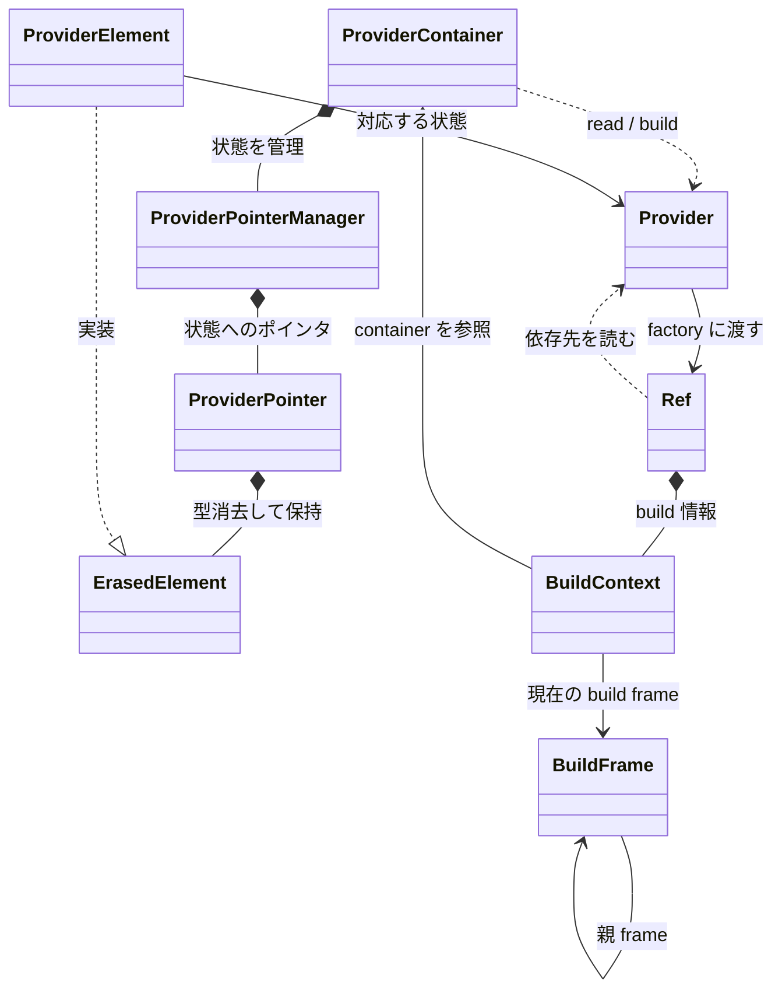

# 全体像

`Provider` が状態の作り方を定義し、`ProviderContainer` が状態を保持します。`ProviderPointer` は `ErasedElement` trait 経由で状態を保持し、実体の `ProviderElement` がその trait を実装します。Provider の生成中は `Ref` と `BuildContext` を使い、`BuildFrame` で依存のたどり方を管理します。
