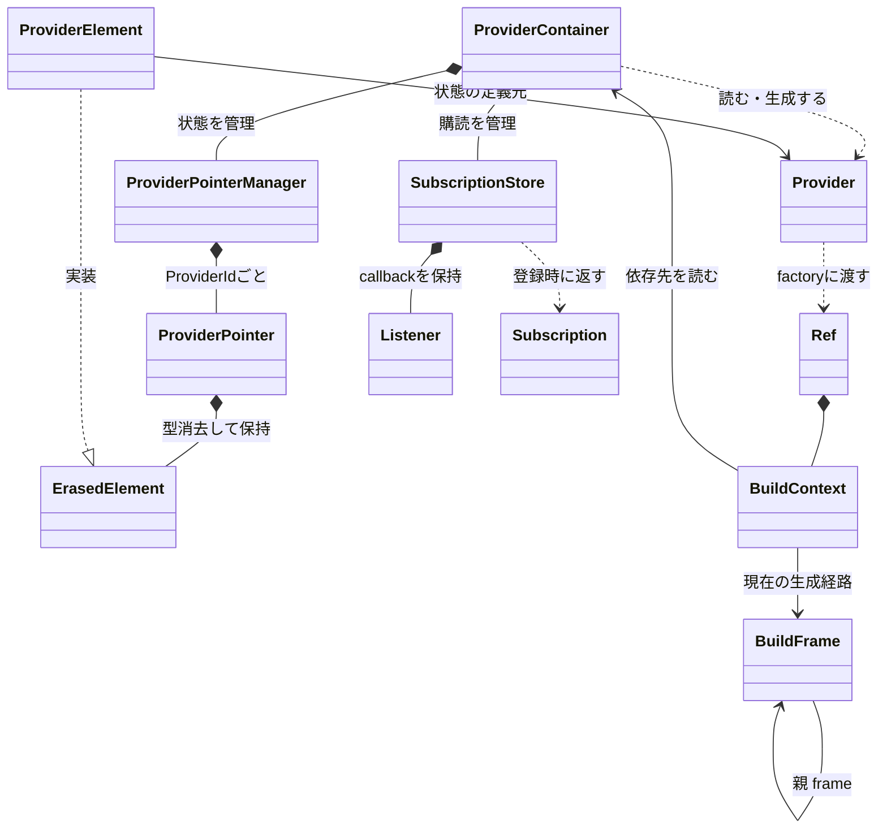

# 全体像

## 初期化・再構築の流れ

1. `ProviderContainer` が `ProviderElement` の状態を確認します。
2. 初期化や再構築が必要なら、provider の factory を `Ref` とともに呼び出します。
3. `Ref` は依存先を読み、`BuildFrame` の親子関係で循環依存を検出します。
4. 生成した値を保存し、値が変わったときは `SubscriptionStore` が listener に通知します。

`Provider` は状態を作る factory とメタデータを持ちます。`ProviderContainer` は `ProviderId` ごとに状態を保持し、購読を管理します。ポインタは element を、listener は callback を、それぞれ型消去して保持します。

`Subscription` は購読解除に使うハンドルです。`ProviderPointerManager`、`ProviderPointer`、`ErasedElement`、`ProviderElement`、`BuildContext`、`BuildFrame`、`SubscriptionStore`、`Listener` は crate 内部の実装型です。
